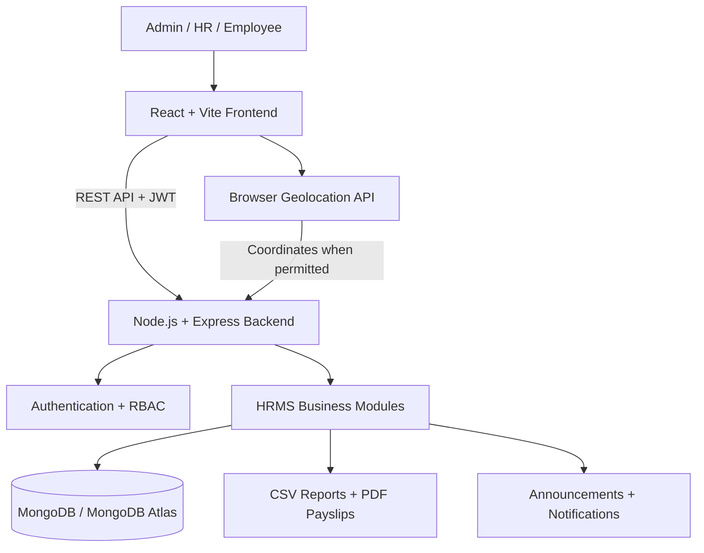

<div align="center">

# 👥 PeopleFlow HRMS

### Modern Human Resource Management System | MERN Stack

**A role-based HR workspace for managing employees, shifts, GPS attendance, leave, payroll, documents, analytics, and company announcements.**


[🌐 Live Demo](https://peopleflow-hrms-xvh5.onrender.com) · [📘 API Reference](#-api-reference) · [⚙️ Setup](#️-local-development-setup) · [🚀 Deployment](#-deployment-on-render)

</div>

---

## 📌 Overview

**PeopleFlow HRMS** is a full-stack Human Resource Management System built using the **MERN stack**. It combines common HR operations in a single application, with separate capabilities for **Admin**, **HR**, and **Employee** users.

The application covers employee administration, shift assignment, location-aware attendance, leave requests and approvals, payroll generation, employee document verification, HR reporting, and targeted internal announcements.

> **Current status:** The frontend and backend are deployed on Render, and the application owner reports that login and application functionality are working. Production security, reliability, and scalability audits have not been completed. Durable private storage is still needed before retaining real employee documents.

## 🔗 Live Links & Screenshots

**Production deployment:** React frontend and Express API are hosted on Render. Screenshots and a demo video can be added later.

| Resource | Link |
|---|---|
| 🌐 Frontend Live Demo | [Open Live App](https://peopleflow-hrms-xvh5.onrender.com) |
| ⚙️ Backend API | [Backend Service](*************) |
| 💻 GitHub Repository | [View Source](https://github.com/sambhavraj71/PeopleFlow-HRMS) |


### Screenshot gallery (add later)

Once screenshots are available, create an `assets/screenshots/` folder and replace the placeholder descriptions below with Markdown image links.

| Screen | Suggested screenshot |
|---|---|
| Dashboard | Overview metrics and recent payroll |
| Employee Management | Employee directory and creation form |
| Shift Management | Shift configuration and employee assignments |
| GPS Attendance | Check-in/out and attendance records |
| HR Analytics | Metrics, charts, and CSV export |
| Announcements | Announcement feed and notification bell |

---

## ✨ Key Features

### 🔐 1. Authentication & Role-Based Access Control

- JWT-based sign-in and protected API routes.
- Three application roles: **Admin**, **HR**, and **Employee**.
- Role-specific navigation, screens, and backend authorization.
- Authenticated profile endpoint for retrieving current user details.

### 👤 2. Employee Management

- Create and view employee records.
- Manage core employee attributes, including name, email, department, designation, role, base salary, and active status.
- Support HR and Admin workflows with employee directory access.

### 🕘 3. Shift Management

- Create shifts with start and end times.
- Configure grace period, break duration, and overtime eligibility.
- Edit shifts and activate or deactivate them.
- Assign shifts to employees and view the shift directory.
- Display assigned shift details on the employee dashboard.

### 📍 4. GPS-Based Attendance

- Check in and check out through the employee workspace.
- Capture browser geolocation when GPS verification is enabled.
- Apply server-side location policy and office-radius/accuracy requirements according to configuration.
- Record shift information, check-in/out times, late minutes, early exits, working time, and overtime.
- Browse monthly attendance records.

> Browser geolocation requires user permission and, in most deployed browsers, a secure HTTPS context. Attendance accuracy depends on device and location services.

### 🗓️ 5. Leave Management

- Submit **annual, sick, casual, and unpaid** leave requests.
- Capture date range and leave reason.
- View leave status and history.
- Allow authorized HR/Admin users to approve or reject requests.

### 💰 6. Payroll & Payslips

- Generate monthly payroll drafts.
- Calculate salary components such as base pay, allowances, bonuses, and deductions.
- Account for approved unpaid leave deductions in payroll calculations.
- View payroll records by month.
- Download PDF payslips.

> This is an application payroll workflow, not a verified tax, statutory compliance, or accounting engine. Advanced salary structures and tax management are future improvements.

### 📁 7. Employee Document Management

- Upload employee documents in **PDF, JPG, or PNG** format.
- Current frontend file-size limit: **5 MB per upload**.
- Support document categories such as resume, Aadhaar, PAN, education certificate, experience certificate, offer letter, and other.
- Allow authorized reviewers to verify or reject submitted documents with reasons.
- Download and manage document records.
- Restrict document operations through backend authorization rules.

> **Privacy:** Use dummy files for demos. Before real employee usage, configure durable private storage, access controls, retention rules, and secure handling of identity documents.

### 📊 8. HR Analytics & Reports

- Overview of workforce and HR activity.
- Employee analytics and summaries.
- Attendance and leave reporting.
- Payroll reporting and trends.
- CSV exports for employee, attendance, leave, and payroll data.
- Month-based reporting where supported by the API.

### 📢 9. Company Announcements & In-App Notifications

- HR/Admin users can create announcement drafts.
- Publish announcements to all employees or a specific department.
- Set priority: **Normal**, **Important**, or **Urgent**.
- Edit drafts and archive announcements.
- Show eligible published announcements in the employee workspace.
- Provide a notification bell, unread count, mark-as-read, and mark-all-as-read actions.
- Refresh notifications periodically from the backend.

> **Not included currently:** Automatic email delivery and WebSocket-based real-time push notifications.

---

## 🧰 Technology Stack

| Layer / Purpose | Technology | Usage in PeopleFlow |
|---|---|---|
| Frontend UI | **React** | Component-based dashboards, forms, tables, and feature screens |
| Frontend tooling | **Vite** | Development server and production frontend builds |
| Language | **JavaScript / JSX** | Frontend and backend application logic |
| Styling | **CSS** | Layout, responsive components, tables, forms, and visual states |
| UI icons | **Lucide React** | Navigation and interface icons |
| Backend runtime | **Node.js** | Server-side JavaScript execution |
| API framework | **Express.js** | REST endpoints, middleware, request handling |
| Database | **MongoDB** | Employee and HRMS application data |
| ODM | **Mongoose** | Schemas, models, relationships, and queries |
| Authentication | **JWT** | Bearer-token authentication |
| Authorization | **RBAC** | Admin, HR, and Employee permissions |
| Reporting | **CSV export / PDF generation** | HR data exports and payslip downloads |
| Browser APIs | **Geolocation API** | GPS attendance location capture |
| Version control | **Git / GitHub** | Source control and deployment integration |
| Planned hosting | **Render** | Node backend web service and Vite static frontend |
| Planned cloud database | **MongoDB Atlas** | Managed MongoDB database |

**Additional implementation details:** API requests use HTTP/JSON with JWT bearer authorization; document uploads use multipart form data; the React frontend reads its API base URL from `VITE_API_URL` when configured.

> The exact PDF, CSV, upload, password-hashing, and other backend package names should be taken from the current `server/package.json` before listing them individually. They are intentionally not guessed here.

---

## 🏗️ System Architecture



### Request lifecycle

1. A user signs in through the React frontend.
2. The backend authenticates the request and issues a JWT upon successful login.
3. The frontend includes the JWT in authorized API requests.
4. Express middleware validates authentication and role permissions.
5. Feature routes perform application operations through Mongoose models.
6. The backend returns JSON responses or downloadable report/document content.

### Role overview

| Capability | Admin | HR | Employee |
|---|:---:|:---:|:---:|
| Sign in and access personal workspace | ✅ | ✅ | ✅ |
| Employee directory / administration | ✅ | ✅ | — |
| Create and assign shifts | ✅ | ✅ | — |
| Submit attendance | ✅* | ✅* | ✅ |
| Request leave | ✅* | ✅* | ✅ |
| Review eligible leave requests | ✅ | ✅ | — |
| Generate payroll drafts | ✅ | ✅ | — |
| Access own documents | Role/ownership rules | Role/ownership rules | ✅ |
| Verify employee documents | ✅ | ✅ | — |
| View HR analytics / exports | ✅ | ✅ | — |
| Publish announcements | ✅ | ✅ | — |
| Read eligible announcements | ✅ | ✅ | ✅ |

*Actual permissions are enforced by backend routes; personal workflows and restrictions depend on the signed-in account and relevant ownership checks. Verify the final deployed role matrix against the backend implementation.*

---

## 📂 Repository Structure

The structure below reflects the main files known from the current project. Additional feature modules may exist in the refactored repository.

```text
peopleflow-hrms/
├── client/
│   ├── src/
│   │   ├── main.jsx                 # React entry / application integration
│   │   ├── HRAnalytics.jsx          # HR analytics and reports
│   │   ├── Announcements.jsx        # Announcement management and feed
│   │   ├── NotificationBell.jsx     # Notification bell and read status
│   │   └── style.css                # Application styles
│   ├── package.json
│   └── ...
├── server/
│   ├── src/
│   │   ├── index.js                 # Backend entry point
│   │   ├── models.js                # Mongoose models
│   │   ├── analyticsRoutes.js       # Analytics / CSV routes
│   │   ├── announcementRoutes.js    # Announcement / notification routes
│   │   └── ...
│   ├── package.json
│   └── ...
├── .gitignore
└── README.md
```

---

## ⚙️ Local Development Setup

### Prerequisites

- **Node.js** and **npm** (use a version compatible with the repository's package configuration).
- **MongoDB**, running locally or available through MongoDB Atlas.
- **Git**.
- A code editor such as VS Code.

### 1. Clone the repository

```bash
git clone https://github.com/sambhavraj71/PeopleFlow-HRMS.git
cd PeopleFlow-HRMS
```


### 2. Configure and run the backend

```bash
cd server
npm install
```

Create `server/.env` with the environment variables **actually read by your backend**. The following is an illustrative example, not a verified configuration contract:

```dotenv
# Example only — check server/src/index.js and config files
MONGO_URI=your_mongodb_connection_string
JWT_SECRET=replace_with_a_long_random_secret
PORT=5000
```

Start using the script available in `server/package.json`:

```bash
npm run dev
```

If no `dev` script exists, use the configured `npm start` command or your actual server entry command.

### 3. Configure and run the frontend

Open another terminal from the repository root:

```bash
cd client
npm install
```

Create `client/.env` for local API access:

```dotenv
VITE_API_URL=http://localhost:5000/api
```

Start the frontend:

```bash
npm run dev
```

Open the URL printed by Vite in your terminal.

### 4. Login / seed data

Use an existing account or the backend's configured seed procedure, if present. **Do not publish real credentials or a production admin password in this README.**

### 5. Production build check

From `client/`:

```bash
npm run build
```

This verifies that the Vite frontend can produce its production build. Also run any test/lint scripts actually defined in your package files.

---

## 🔌 API Reference

The backend uses the `/api` prefix. The endpoints below summarize known routes; all protected routes require a valid JWT and some require Admin/HR permissions.

### Authentication and core modules

| Method | Endpoint | Purpose |
|---|---|---|
| `POST` | `/api/auth/login` | Sign in |
| `GET` | `/api/auth/me` | Current user profile |
| `GET` | `/api/dashboard` | Dashboard summary |
| `GET` | `/api/employees` | Employee directory (authorized roles) |
| `POST` | `/api/employees` | Create employee (authorized roles) |
| `GET` | `/api/shifts` | List shifts |
| `POST` | `/api/shifts` | Create shift |
| `PATCH` | `/api/shifts/:id` | Update shift |
| `PATCH` | `/api/employees/:id/shift` | Assign employee shift |
| `GET` | `/api/attendance?month=YYYY-MM` | Monthly attendance |
| `GET` | `/api/attendance/config` | Attendance GPS policy |
| `POST` | `/api/attendance/check-in` | GPS attendance check-in |
| `POST` | `/api/attendance/check-out` | GPS attendance check-out |
| `GET` | `/api/leaves` | Leave requests |
| `POST` | `/api/leaves` | Submit leave request |
| `PATCH` | `/api/leaves/:id/status` | Review leave request |
| `GET` | `/api/payroll?month=YYYY-MM` | Payroll records |
| `POST` | `/api/payroll/generate` | Generate payroll drafts |
| `GET` | `/api/payroll/:id/payslip` | Download PDF payslip |

### Employee documents

| Method | Endpoint | Purpose |
|---|---|---|
| `GET` | `/api/documents` | List authorized documents |
| `POST` | `/api/documents/upload` | Upload employee document |
| `GET` | `/api/documents/:id/file` | Download document |
| `PATCH` | `/api/documents/:id/verify` | Verify or reject document |
| `DELETE` | `/api/documents/:id` | Delete document |

### Analytics and exports

| Method | Endpoint | Purpose |
|---|---|---|
| `GET` | `/api/analytics/overview?month=YYYY-MM` | Analytics overview |
| `GET` | `/api/analytics/employees` | Employee analytics |
| `GET` | `/api/analytics/attendance?month=YYYY-MM` | Attendance analytics |
| `GET` | `/api/analytics/leaves?month=YYYY-MM` | Leave analytics |
| `GET` | `/api/analytics/payroll?month=YYYY-MM` | Payroll analytics |
| `GET` | `/api/reports/export?type=employees&month=YYYY-MM` | CSV export; supported types include employees, attendance, leaves, and payroll |

### Announcements and notifications

| Method | Endpoint | Purpose |
|---|---|---|
| `GET` | `/api/announcements` | List announcements visible to the user |
| `POST` | `/api/announcements` | Create draft or published announcement (HR/Admin) |
| `PATCH` | `/api/announcements/:id` | Edit a draft (HR/Admin) |
| `PATCH` | `/api/announcements/:id/publish` | Publish a draft (HR/Admin) |
| `DELETE` | `/api/announcements/:id` | Archive an announcement (HR/Admin) |
| `GET` | `/api/notifications` | List user's notifications |
| `GET` | `/api/notifications/unread-count` | Count unread notifications |
| `PATCH` | `/api/notifications/:id/read` | Mark one notification as read |
| `PATCH` | `/api/notifications/read-all` | Mark all as read |

### Example authenticated request

```bash
curl -H "Authorization: Bearer YOUR_JWT_TOKEN" \
  "http://localhost:5000/api/announcements"
```

### Example announcement payload

```json
{
  "title": "Holiday Notice",
  "content": "The office will remain closed on the announced holiday.",
  "priority": "important",
  "audience": "all",
  "status": "draft"
}
```

> Never include live JWTs, passwords, or personal employee records in public documentation or screenshots.

---

## 🚀 Deployment on Render

**Live architecture:** [GitHub repository](https://github.com/sambhavraj71/PeopleFlow-HRMS) → [Render Web Service (backend)](https://peopleflow-backend-delj.onrender.com) + [Render Static Site (frontend)](https://peopleflow-hrms-xvh5.onrender.com) → MongoDB Atlas.

### Backend: Render Web Service

| Setting | Production configuration |
|---|---|
| Source | `sambhavraj71/PeopleFlow-HRMS` (`main`) |
| Root Directory | `server` |
| Runtime | Node |
| Build Command | `npm ci` (if `package-lock.json` exists) |
| Start Command | `npm start` |
| Environment | `MONGO_URI`, `JWT_SECRET`, `CLIENT_URL` and other variables required by code |
| `CLIENT_URL` | `https://peopleflow-hrms-xvh5.onrender.com` (no trailing slash) |

**Before deployment:**

1. Create a MongoDB Atlas cluster and database user with appropriate permissions.
2. Configure Atlas network access securely for the deployment environment.
3. Set backend secrets in Render environment settings; do **not** commit `.env`.
4. Ensure Express listens on the Render-provided `PORT` and an appropriate network interface.
5. Configure CORS to allow the deployed frontend origin.
6. Check backend logs and verify login and API responses.

### Frontend: Render Static Site

| Setting | Production configuration |
|---|---|
| Source | `sambhavraj71/PeopleFlow-HRMS` (`main`) |
| Root Directory | `client` |
| Build Command | `npm ci && npm run build` (if lockfile exists) |
| Publish Directory | `dist` |
| `VITE_API_URL` | `https://peopleflow-backend-delj.onrender.com/api` (no trailing slash) |

If using client-side routes that rely on browser history, configure a static-site rewrite to `index.html` as appropriate for the router in use.

> **Vite environment variables:** `VITE_` variables are embedded into the frontend bundle. Never put secrets, passwords, or private API keys in them. After changing `VITE_API_URL`, rebuild/redeploy the frontend.

### Deployment verification checklist

The application owner has confirmed that the live deployment and login are working. The remaining checks should be validated individually before production use.

- [x] Latest changes pushed to GitHub.
- [x] Backend starts successfully on Render.
- [ ] MongoDB Atlas connection succeeds.
- [x] Frontend loads over HTTPS.
- [x] Frontend uses the correct deployed API URL.
- [x] CORS allows the deployed frontend origin.
- [ ] Admin, HR, and Employee sign-in works.
- [ ] Role restrictions and ownership checks work.
- [ ] Shift management and GPS attendance work in browser.
- [ ] Leave requests and approvals work.
- [ ] Payroll calculations and PDF downloads work.
- [ ] CSV analytics exports work.
- [ ] Announcements and notification read status work.
- [ ] Document uploads/downloads use persistent, access-controlled storage.
- [ ] No secrets or personal documents are exposed publicly.

### ⚠️ Persistent document storage

Render's standard local filesystem is **ephemeral**. Files written only to the service filesystem can disappear after restarts or redeployments. Before using real employee documents, configure durable private object storage (for example, a suitable S3-compatible service) and authorized download access. This is a deployment blocker for real document retention.

---

## 🛡️ Security & Privacy Considerations

PeopleFlow handles HR data, which may include personally identifiable and sensitive employment information. Production deployment should address:

- **Authentication:** Strong JWT secrets, token expiry, secure login handling, and account lifecycle controls.
- **Authorization:** Enforce permissions on the backend, including employee ownership checks; hiding a UI button is not sufficient.
- **Password handling:** Secure hashing and credential policies; never store plaintext passwords.
- **Input validation:** Validate all API payloads, dates, amounts, file types, and document ownership.
- **File security:** Enforce upload limits, safe storage keys, private access, and retention rules.
- **GPS privacy:** Collect location only when necessary, with appropriate notice and permissions.
- **Transport security:** Use HTTPS for frontend, API, and storage connections.
- **CORS and secrets:** Restrict allowed origins and manage credentials through environment settings.
- **Monitoring and backups:** Add application logging, database backups, and recovery procedures.
- **Compliance:** Review applicable labor, privacy, payroll, and tax requirements before actual organizational use.

These are **production requirements/recommendations**, not claims that every control is already implemented.

---

## 🧪 Testing & Quality Assurance

### Recommended test scenarios

| Area | Example checks |
|---|---|
| Authentication | Valid/invalid login, expired token, missing token |
| Authorization | Employee cannot access HR-only APIs; users cannot access another employee's private data |
| Shifts | Invalid times, inactive shifts, assignment updates |
| Attendance | GPS denied, inaccurate location, outside radius, duplicate check-in, missing check-out |
| Leave | Invalid date ranges, overlapping requests, review permissions |
| Payroll | Unpaid leave calculations, zero/negative values, repeat generation, PDF output |
| Documents | Unsupported file type, oversized upload, unauthorized download, review workflow |
| Analytics | Month filtering, empty data, CSV format, restricted access |
| Announcements | Department targeting, draft visibility, expiry, unread count, archive behavior |

Automated unit/integration tests and CI/CD are planned improvements unless they are separately present in the current repository.

---

## 🗺️ Roadmap

### Implemented core modules

- [x] JWT authentication and role-based authorization
- [x] Employee management
- [x] Shift management and assignment
- [x] GPS attendance and working-time tracking
- [x] Leave request and review workflow
- [x] Monthly payroll and PDF payslips
- [x] Employee document management and verification
- [x] HR analytics and CSV exports
- [x] Company announcements and in-app notifications

### Deployment and future enhancements

- [x] Public Render deployment and successful login reported
- [ ] Formal end-to-end regression testing of every module
- [ ] Durable private document storage
- [ ] Automated backend/frontend tests
- [ ] GitHub Actions CI/CD
- [ ] Pagination, search, and query optimization
- [ ] Audit logs, monitoring, and production observability
- [ ] Advanced salary structure and tax management
- [ ] Employee onboarding and offboarding
- [ ] Optional email notifications and real-time push updates

---

## 💡 Engineering Highlights

This project demonstrates practical full-stack development concepts relevant to MERN roles:

- Designing feature-oriented REST APIs and connecting them to React interfaces.
- Modeling related HR entities with MongoDB and Mongoose.
- Implementing JWT authentication and role-based workflows.
- Handling browser geolocation and attendance business rules.
- Building multi-step approval and verification workflows.
- Generating downloadable reports and payslips.
- Separating employee-facing and HR/Admin functionality.
- Deploying and configuring a multi-service application on Render.

---

## 🤝 Contributing

This is currently a portfolio/development project. If you plan to accept contributions, add contribution guidelines, issue templates, and a code of conduct as appropriate.

## 📄 License

**No license has been declared.** Add a `LICENSE` file if you want to grant open-source reuse rights. Until then, do not assume the repository is licensed for unrestricted reuse.

---

<div align="center">

**PeopleFlow HRMS — Simplifying workforce operations through a unified MERN workspace.**

[**Launch Live Application**](https://peopleflow-hrms-xvh5.onrender.com) · [**View Source Code**](https://github.com/sambhavraj71/PeopleFlow-HRMS)

</div>
